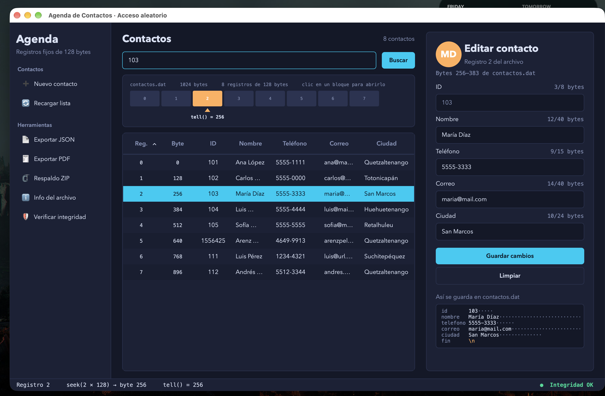

# Agenda de Contactos con Acceso Aleatorio

Aplicación de escritorio en Python que gestiona contactos en un archivo de **registros de tamaño fijo** (`contactos.dat`), con acceso aleatorio mediante `seek()` y `tell()`, índice primario en JSON, verificación de integridad SHA-256, exportación a JSON/PDF y respaldos ZIP.

Proyecto del curso **Manejo e Implementación de Archivos**, Universidad Rafael Landívar, Campus Quetzaltenango.



## Funcionalidades

- **Agregar** contactos al final del archivo (`seek(0, SEEK_END)`).
- **Buscar por ID** con el índice primario: índice → número de registro → `seek(n × 128)` → `read(128)`.
- **Modificar en el lugar**: solo se sobrescriben los 128 bytes del registro, sin reescribir el archivo.
- **Mapa del archivo**: muestra cada registro como un bloque, la posición de `tell()` y permite abrir un registro con un clic.
- **Contador de bytes en vivo** por campo (UTF-8) y vista del registro tal como queda en disco.
- **Integridad SHA-256**: se actualiza tras cada cambio y se verifica al iniciar.
- **Exportar** a JSON y generar un **reporte PDF** (fpdf2) a partir del JSON.
- **Respaldo ZIP** de los datos con comparación de tamaño original y comprimido.
- **Información del archivo**: tamaño, fechas y permisos (`os.stat`, `os.access`).
- **Manejo de errores**: archivo inexistente, corrupto, alterado, sin permisos, índice dañado e ID inexistente.

## Estructura del registro (128 bytes)

| Campo    | Bytes |
|----------|------:|
| id       | 8     |
| nombre   | 40    |
| telefono | 15    |
| correo   | 40    |
| ciudad   | 24    |
| `\n`     | 1     |
| **Total**| **128** |

Los largos se miden en **bytes UTF-8** (la `ñ` y las vocales con tilde ocupan 2 bytes). Cada campo se rellena con espacios hasta su largo.

## Estructura del proyecto

```
agenda_contactos/
├── main.py              # punto de entrada
├── nucleo/              # lógica de archivos (no depende de la interfaz)
│   ├── config.py        # rutas y estructura del registro
│   ├── registro.py      # Contacto, validación, empaquetar/desempaquetar
│   ├── almacenamiento.py# acceso aleatorio con seek()/tell()
│   ├── indice.py        # índice primario id -> registro (JSON)
│   ├── integridad.py    # SHA-256
│   └── agenda.py        # coordina archivo, índice e integridad
├── herramientas/        # exportar JSON/PDF, respaldo ZIP, info del archivo
├── interfaz/            # PySide6: ventana, paneles, mapa, estilos
├── entregables/         # archivos generados por la aplicación
└── caso.sh              # script para reproducir los casos de error
```

## Instalación y ejecución

Requiere Python 3.10 o superior.

```bash
git clone https://github.com/Arenzzzz/agenda-contactos.git
cd agenda-contactos
python3 -m venv venv
source venv/bin/activate        # Windows: venv\Scripts\activate
pip install -r requirements.txt
python3 main.py
```

Los datos se crean en `datos/`, las exportaciones en `exportaciones/` y los respaldos en `respaldos/`.

## Pruebas de errores

`caso.sh` prepara cada caso partiendo de una copia limpia de los datos (`datos_copia/`):

| Caso | Comando | Resultado esperado |
|---|---|---|
| Archivo inexistente | `./caso.sh 1` | Aviso y archivo nuevo vacío |
| Archivo corrupto | `./caso.sh 2` | "No es múltiplo de 128", la app no abre |
| Alterado a mano | `./caso.sh 3` | Aviso con hash guardado y hash actual |
| Índice dañado | `./caso.sh 4` | El índice se reconstruye |
| Solo lectura | `./caso.sh 5` | Abre, pero no permite guardar |
| Sin permisos | `./caso.sh 6` | Aviso, la app no abre |

## Autor

Moshé Arenz Peláez Virula